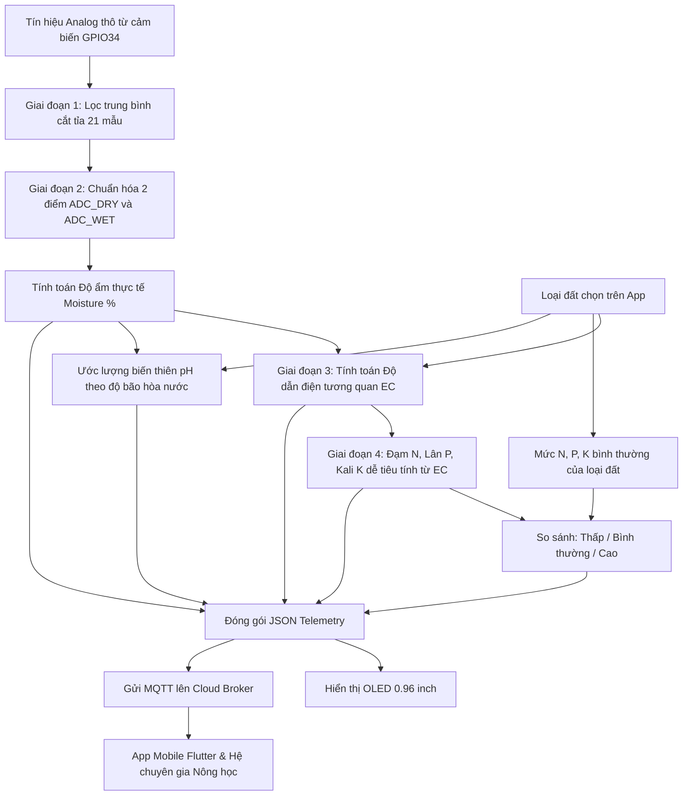

# SOIL NUTRIENT ANALYSIS AND MONITORING SYSTEM
## BẢN ĐẶC TẢ KỸ THUẬT VÀ KIẾN TRÚC DỰ ÁN (PROJECT SPECIFICATION)
### Đề tài: Hệ thống IoT Phân tích Dinh dưỡng Đất - Ước lượng NPK từ Độ ẩm Đất bằng Thuật toán Thực nghiệm

---

### 1. TỔNG QUAN DỰ ÁN (EXECUTIVE SUMMARY)
* **Tên đề tài**: Hệ thống IoT phân tích dinh dưỡng đất: Ước lượng NPK từ độ ẩm đất (Smart Soil Nutrient Analysis System: Heuristic NPK Estimation from Soil Moisture).
* **Nền tảng công nghệ**: Vi điều khiển ESP32, Cảm biến độ ẩm đất điện dung/nước, Giao thức MQTT (broker riêng EMQX Serverless, có tài khoản và ACL), Ứng dụng di động Flutter (Android/iOS/macOS).
* **Bối cảnh & Tính cấp thiết**:
  - Cảm biến NPK chuyên dụng trên thị trường có giá thành rất cao (hàng triệu đồng) và điện cực đo nhanh bị oxy hóa, ăn mòn khi cắm lâu trong đất; phân tích hóa nghiệm phòng lab thì tốn kém và mất nhiều ngày.
  - Cảm biến độ ẩm đất có giá thành rất rẻ (15.000đ – 30.000đ), bền bỉ, dễ triển khai đo liên tục theo thời gian thực.
* **Mục tiêu cốt lõi**:
  - Chế tạo trạm đo IoT giá rẻ (Edge Node) sử dụng vi điều khiển **ESP32** và **cảm biến độ ẩm đất**.
  - Ứng dụng **Thuật toán suy diễn thực nghiệm (Empirical Heuristic Estimation Algorithm)** chạy trực tiếp trên chip ESP32 (Edge Computing) để ước lượng các chỉ số: **Độ ẩm (%), EC (độ dẫn điện/độ phì), Đạm (N), Lân (P), Kali (K) và pH**.
  - Hiển thị thông số trực tiếp tại chỗ qua màn hình **OLED 0.96 inch SSD1306**.
  - Truyền dữ liệu hai chiều thời gian thực qua giao thức mạng **MQTT** với định dạng **JSON**.
  - Tích hợp **Hệ chuyên gia Nông học (Rule-based Agronomic Engine)** trên ứng dụng di động **Flutter**: hiển thị N, P, K, độ ẩm, pH, EC so với mức chuẩn, chẩn đoán độ màu mỡ của đất và tự động xuất khuyến nghị cải tạo đất theo Ngưỡng Đất Màu Mỡ Chuẩn Nông Nghiệp.

---

### 2. DANH MỤC PHẦN CỨNG & SƠ ĐỒ KẾT NỐI (HARDWARE BOM & PINOUT)

#### 2.1. Danh sách linh kiện (Hardware BOM - Tận dụng 100% từ Starter Kit)
| STT | Tên linh kiện | Vai trò trong hệ thống | Ghi chú an toàn |
|:---:|---|---|---|
| 1 | **Board ESP32-WROOM-32** (30/38 chân) | Bộ xử lý trung tâm (Edge Node): Đọc ADC, chạy giải thuật ước lượng, phát WiFi/MQTT | Cấp nguồn qua cổng USB 5V |
| 2 | **Cảm biến độ ẩm đất / Cảm biến nước** | Đầu dò cảm biến đo điện trở/điện dung đất | **Cấp nguồn 3V3** (TUYỆT ĐỐI không cắm 5V vào chân ADC) |
| 3 | **Màn hình OLED 0.96 inch I2C** (SSD1306) | Hiển thị thông số đất tức thời tại trạm đo | Giao tiếp I2C (địa chỉ `0x3C`) |
| 4 | **Còi Buzzer + LED đỏ/vàng/xanh** | Đèn báo 3 mức; còi kêu 3 tiếng khi đất vừa chuyển sang quá khô (< 35%) hoặc ngập úng (> 80%) | Còi GPIO25 (phát PWM, còi chủ động hay thụ động đều được), LED GPIO32 / GPIO19 / GPIO33 |
| 5 | **Breadboard MB102 & Dây cắm đực-cái** | Kết nối mạch cắm không cần dùng mỏ hàn | Dễ tháo lắp khi thử nghiệm |

#### 2.2. Sơ đồ kết nối chân vi điều khiển (ESP32 Pinout Mapping)

```
       +----------------------------------------------------+
       |                    ESP32 BOARD                     |
       +----------------------------------------------------+
            |
            | GPIO34 (ADC1) <----  Chân SIG (Cảm biến nước / độ ẩm đất)
            | 3V3           ---->  Chân VCC (Cảm biến độ ẩm) [AN TOÀN!]
            | GND           ---->  Chân GND (Cảm biến độ ẩm)
            |
            | GPIO21 (SDA)  <--->  SDA (Màn hình OLED 0.96" I2C)
            | GPIO22 (SCL)  ---->  SCL (Màn hình OLED 0.96" I2C)
            | 3V3 / GND     ---->  Cấp nguồn nuôi OLED
            |
            | GPIO25        ---->  Cực Dương (+) Còi Buzzer (Cực âm nối GND)
            | GPIO32        ---->  LED Đỏ cảnh báo (qua điện trở 220Ω, âm nối GND)
            | GPIO19        ---->  LED Vàng cần chú ý (qua điện trở 220Ω, âm nối GND)
            | GPIO33        ---->  LED Xanh báo bình thường (qua điện trở 220Ω, âm nối GND)
            +----------------------------------------------------+
```

> [!IMPORTANT]
> **QUY TẮC AN TOÀN SỐNG CÒN**:
> 1. Chân tín hiệu cảm biến **bắt buộc nối vào chân ADC1 (GPIO34)**. Không cắm vào các chân ADC2 (như GPIO2, GPIO4, GPIO12...) vì ADC2 bị ngắt nội bộ khi ESP32 kích hoạt WiFi.
> 2. Cấp nguồn cảm biến bằng chân **3V3** để bảo vệ bộ chuyển đổi ADC 12-bit của ESP32 không bị quá áp.

---

### 3. THUẬT TOÁN SUY DIỄN THỰC NGHIỆM ƯỚC LƯỢNG NPK (ALGORITHM DESIGN)

Thay vì dùng mô hình học máy "hộp đen" phức tạp đòi hỏi máy chủ cấu hình cao, hệ thống sử dụng **Thuật toán suy diễn thực nghiệm biên (Edge Heuristic Estimation Algorithm)** chạy trực tiếp trên vi điều khiển ESP32 với độ phức tạp $O(1)$:



#### Công thức toán học của Thuật toán:

1. **Lọc nhiễu trung bình cắt tỉa (Trimmed Mean Filter)**: Đọc 21 mẫu, sắp xếp tăng dần, bỏ 5 mẫu thấp nhất và 5 mẫu cao nhất rồi lấy trung bình 11 mẫu giữa, nhờ đó các gai nhiễu do chạm dây bị loại hẳn:
   $$ADC_{filtered} = \frac{1}{11} \sum_{i=6}^{16} ADC_{sorted}(i)$$
   Trạm gửi kèm độ lệch chuẩn của 21 mẫu thô (`adc.noise`) để đánh giá mức nhiễu thật khi đo ngoài đất.

2. **Hiệu chuẩn độ ẩm thể tích $\theta$ (%)**:
   $$\theta = \text{constrain}\left( \frac{ADC_{filtered} - ADC_{DRY}}{ADC_{WET} - ADC_{DRY}} \times 100, \ 0, \ 100 \right)$$
   *(Trong đó $ADC_{DRY}$ là mốc khô trong không khí, $ADC_{WET}$ là mốc ngâm nước. Giá trị mặc định 200 / 3000 chỉ để chạy thử; với cảm biến thật, hai mốc được đo lại bằng màn **Hiệu chuẩn** trên App (lệnh `CALIBRATE`) và lưu vào flash. Module LM393/FC-28 cho ADC giảm khi ướt nên $ADC_{DRY} > ADC_{WET}$, công thức tự đảo chiều).*

3. **Ước lượng Độ dẫn điện dung dịch đất (Pore Solution EC - $\mu S/cm$)**:
   Theo định luật vật lý đất, khi độ ẩm tăng, các muối khoáng ion hòa tan linh động hơn. Tốc độ tăng phụ thuộc loại đất đang đo (chọn trên App):
   $$EC = \theta \times k_{EC}$$

   | Loại đất (mã MQTT) | Dự đoán dinh dưỡng | $k_{EC}$ ($\mu S/cm$ mỗi 1% ẩm) | $pH_{0}$ | $N_0$ | $P_0$ | $K_0$ (mg/kg, mức bình thường) |
   |---|---|---|---|---|---|---|
   | Đất dinh dưỡng đóng bao (`potting`) | Cao | 20.0 | 6.2 | 95 | 50 | 135 |
   | Đất vườn - đất thịt (`garden`, mặc định) | Trung bình | 13.5 | 6.5 | 65 | 33 | 90 |
   | Đất bạc màu / bãi đất trống (`barren`) | Thấp | 4.0 | 5.8 | 20 | 10 | 30 |

4. **Ước lượng N, P, K dễ tiêu (mg/kg)**: cây chỉ hút được phần dinh dưỡng đã hòa tan vào nước trong đất, và chính lượng ion hòa tan đó làm EC tăng. Vì vậy N, P, K được tính từ EC (tức là đổi theo độ ẩm đo được), với hệ số chung cho mọi loại đất:
   $$N = 0.08 \times EC, \quad P = 0.04 \times EC, \quad K = 0.11 \times EC$$
   Hệ số được chọn sao cho ở độ ẩm lý tưởng 60% (giữa khoảng 50 - 70%), mỗi loại đất cho đúng mức bình thường $N_0, P_0, K_0$ của nó. Ví dụ đất vườn ẩm 60%: $EC = 60 \times 13.5 = 810$, suy ra $N = 64.8$, $P = 32.4$, $K = 89.1$.

   **So với mức bình thường của loại đất**: $N_0, P_0, K_0$ trong bảng trên không phải số đo mà là mức N, P, K bình thường của loại đất, dùng để thông báo. Mỗi chỉ số lệch dưới 20% so với mức này là *bình thường*, thấp hơn 80% là *thấp*, cao hơn 120% là *cao*. OLED hiện `Chuan:65/33/90 OK` (hoặc `THAP` / `CAO`), bản tin MQTT có thêm `npk_normal` và `npk_level`, đèn vàng sáng khi có chỉ số *thấp*.

   Trạm chỉ đo thật độ ẩm, nên N, P, K vẫn là số ước lượng: đất khô thì báo thấp, đất rất ẩm thì báo cao, kể cả khi lượng phân trong đất không đổi. Muốn có N, P, K đo thật cần cảm biến NPK chuyên dụng, nằm ngoài phạm vi đề tài (đề tài chọn hướng ước lượng bằng thuật toán).
5. **Độ chua (pH)**: Dao động quanh $pH_{0}$ của loại đất, hơi chua khi úng nước và kiềm hóa khi khô hạn:
   $$pH = pH_{0} - ((\theta - 50.0) \times 0.012)$$

---

### 4. GIAO THỨC TRUYỀN THÔNG MQTT CLOUD

* **Broker**: Broker riêng **EMQX Serverless** `y0601019.ala.asia-southeast1.emqxsl.com`, chỉ mở cổng `8883` (MQTT qua **TLS**) và `8084` (WebSocket qua TLS, đường dẫn `/mqtt`), không cho đăng nhập khi không có tài khoản. ESP32 xác thực chứng chỉ broker bằng Root CA trong [`root_ca.h`](firmware/src/root_ca.h) (chuỗi chứng chỉ của broker kết thúc ở DigiCert Global Root G2). Mỗi bên đăng nhập bằng một tài khoản và chỉ được làm đúng việc của mình. Phân quyền (ACL) đặt trên trang quản lý EMQX: mỗi tài khoản có các luật Allow ở tab Username, việc nào không khớp thì bị luật `#` Deny ở tab All Users chặn.

  | Tài khoản | Dùng cho | Được gửi (publish) | Được nhận (subscribe) |
  |---|---|---|---|
  | `soil_station` | ESP32, `scripts/simulate_station.py`, `simulator/index.html` | telemetry, status | command |
  | `soil_app` | App Flutter | command | telemetry, status |
  | `soil_web` | `web/evaluation.html` | không có | telemetry, status |

  Mật khẩu chỉ nằm trong `firmware/src/secrets.h` (mẫu: [`secrets.example.h`](firmware/src/secrets.example.h)) và `mobile/mqtt_config.json` (mẫu: [`mqtt_config.example.json`](mobile/mqtt_config.example.json)). Hai file thật đã nằm trong `.gitignore`. App chạy bằng `flutter run --dart-define-from-file=mqtt_config.json`. Lệnh `python scripts/test_broker_acl.py` kiểm tra lại toàn bộ: không có tài khoản hoặc sai mật khẩu thì bị từ chối, tài khoản App không gửi được số đo giả, trạm không tự gửi lệnh được, LWT vẫn tới App.

  Thiếu hai file cấu hình thì trạm và App dùng broker công cộng `broker.emqx.io` (có TLS nhưng không có tài khoản, ai biết topic cũng đọc và gửi được), chỉ nên dùng để thử nhanh. Riêng khi chạy mô phỏng trên Wokwi (mạng `Wokwi-GUEST`), trạm dùng cổng `1883` không mã hóa vì mạng ảo của Wokwi không bắt tay TLS được (đã thử cả `www.google.com:443` cũng bị ngắt). Broker riêng không mở cổng 1883, nên muốn chạy Wokwi thì phải build khi chưa có `secrets.h`, lúc đó trạm nối `broker.emqx.io`. Ở mạng WiFi thật trạm luôn dùng TLS.
* **Topic Telemetry** (`soil_station/1/telemetry`): ESP32 gửi dữ liệu định kỳ mỗi 4 giây.
* **Topic Command** (`soil_station/1/command`): Lệnh chọn loại đất đang đo (`{"action": "SET_SOIL_TYPE", "soil_type": "garden"}`, giá trị `potting` / `garden` / `barren`) và lệnh hiệu chuẩn (`{"action": "CALIBRATE", "point": "dry"}` hoặc `"wet"`: trạm lấy ADC đang đọc làm mốc, từ chối nếu cách mốc còn lại dưới 300 khi mốc đó đã được đo thật; không so với số mặc định 200 / 3000). Sau mỗi lệnh trạm gửi ngay một bản tin telemetry để App xác nhận. ESP32 lưu loại đất và mốc hiệu chuẩn vào flash (NVS) nên khởi động lại vẫn giữ.
* **Topic Status** (`soil_station/1/status`): Trạm kết nối xong thì đăng `{"status": "online", "device": ...}` (giữ lại trên broker) và gửi lại 30 giây 1 lần; mất kết nối đột ngột thì broker tự đăng `{"status": "offline"}` qua LWT. Gửi lại định kỳ vì khi trạm khởi động lại, phiên cũ còn treo trên broker khoảng 22 giây rồi LWT `offline` của nó mới được đăng, đè lên `online` của phiên mới.

#### Cấu trúc Payload mẫu (JSON):
`timestamp` là giờ thực Unix lấy từ NTP (`pool.ntp.org`, múi giờ UTC+7); khi trạm chưa đồng bộ được giờ thì bỏ trống và App dùng giờ nhận bản tin. Trạm chưa có cảm biến nhiệt nên không gửi `temperature`. Khối `npk_normal` là mức N, P, K bình thường của loại đất, `npk_level` cho biết từng chỉ số đang `low` / `normal` / `high` so với mức đó. Khối `adc` phục vụ màn Hiệu chuẩn.
```json
{
  "device_id": "esp32_soil_station_01",
  "timestamp": 1764000000,
  "soil_type": "garden",
  "telemetry": {
    "nitrogen": 59.4,
    "phosphorus": 29.7,
    "potassium": 81.7,
    "ph": 6.4,
    "ec": 742.5,
    "moisture": 55.0
  },
  "npk_normal": {
    "nitrogen": 65,
    "phosphorus": 33,
    "potassium": 90
  },
  "npk_level": {
    "nitrogen": "normal",
    "phosphorus": "normal",
    "potassium": "normal"
  },
  "adc": {
    "raw": 1740,
    "noise": 6.2,
    "dry": 200,
    "wet": 3000
  }
}
```

---

### 5. HỆ CHUYÊN GIA NÔNG HỌC (AGRONOMIC RULE ENGINE) TRÊN APP

Hệ chuyên gia được tích hợp sẵn trong Mobile App Flutter ([`AgronomicEngine`](../mobile/lib/services/agronomic_engine.dart)), đối chiếu số liệu ước lượng với Ngưỡng Đất Màu Mỡ Chuẩn Thổ Nhưỡng Nông Nghiệp (pH 6.0-7.2, EC 500-1500, N 50-100, P 30-70, K 80-150, Độ ẩm 50-70%):

* **Đất chua phèn ($pH < 5.5$)**: Cảnh báo rễ khó hấp thu Lân $\rightarrow$ Gợi ý bón vôi nông nghiệp / dolomite.
* **Đất ngộ độc muối ($EC > 1800 \ \mu S/cm$)**: Cảnh báo cháy rễ $\rightarrow$ Khuyến nghị ngừng bón phân, tưới xả nước ngọt.
* **Đất khô cằn ($\theta < 40\%$)**: Cảnh báo thiếu ẩm $\rightarrow$ Gợi ý tưới thêm nước để giữ độ ẩm 50 - 70%.
* **Thiếu Đạm/Lân/Kali**: Tính độ chênh lệch $\Delta N, \Delta P, \Delta K$ và gợi ý công thức phân bón tương ứng (Urê, Super Lân, Kali Sunfat hoặc NPK cân đối).

**Lịch sử đo**: App lưu số đo vào SQLite trên điện thoại ([`HistoryRepository`](mobile/lib/services/history_repository.dart)), mỗi phút 1 bản ghi, giữ 30 ngày. Màn Lịch sử vẽ biểu đồ từng chỉ số theo 24 giờ / 7 ngày / 30 ngày (kèm dải ngưỡng chuẩn) và bảng trung bình theo ngày, tách theo loại đất. App chỉ ghi khi đang mở và nhận được dữ liệu; muốn ghi liên tục 24/7 cần một máy chủ đăng ký topic telemetry và lưu vào CSDL.

---

### 6. CẤU TRÚC THƯ MỤC DỰ ÁN

```
soil-nutrient-analysis-system/
├── README.md              # Giới thiệu & tổng quan dự án
├── SPECIFICATION.md       # Bản đặc tả kỹ thuật chi tiết (file này)
├── HARDWARE_CHECKLIST.md  # Danh mục linh kiện và sơ đồ đấu nối
├── plans/                 # Kế hoạch 5 giai đoạn triển khai chi tiết
├── firmware/              # Mã nguồn C++ cho ESP32 (Arduino / PlatformIO)
│   ├── src/main.cpp       # Code nhúng: ADC, Thuật toán ước lượng, OLED, MQTT
│   ├── diagram.json       # Sơ đồ mạch ảo mô phỏng trên Wokwi
│   └── wokwi.toml         # Cấu hình Wokwi
├── simulator/             # Trình giả lập trạm đo Web UI chạy trực tiếp trên máy
│   └── index.html         # Giao diện OLED ảo + Cảm biến nước Slider
├── scripts/               # Script giả lập Python kiểm thử mạng MQTT
│   ├── simulate_station.py
│   └── test_broker_acl.py # Kiểm tra tài khoản và ACL của broker riêng
└── mobile/                # Ứng dụng di động Flutter (Android, iOS, macOS)
```
