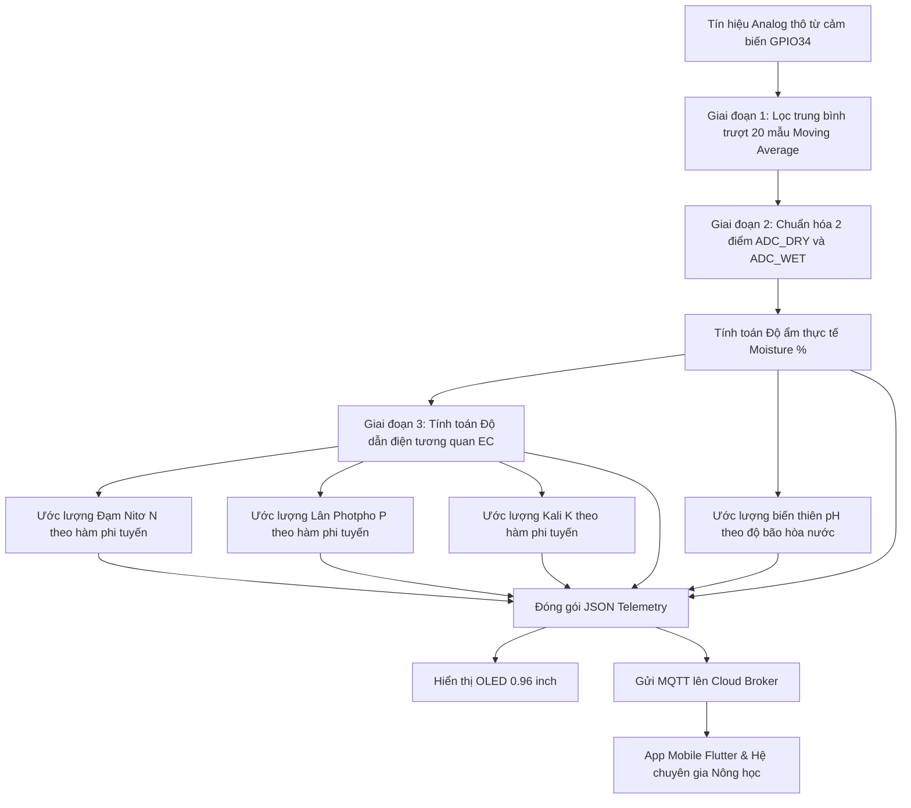

# SOIL NUTRIENT ANALYSIS AND MONITORING SYSTEM
## BẢN ĐẶC TẢ KỸ THUẬT VÀ KIẾN TRÚC DỰ ÁN (PROJECT SPECIFICATION)
### Đề tài: Hệ thống IoT Phân tích Dinh dưỡng Đất - Ước lượng NPK từ Độ ẩm Đất bằng Thuật toán Thực nghiệm

---

### 1. TỔNG QUAN DỰ ÁN (EXECUTIVE SUMMARY)
* **Tên đề tài**: Hệ thống IoT phân tích dinh dưỡng đất: Ước lượng NPK từ độ ẩm đất (Smart Soil Nutrient Analysis System: Heuristic NPK Estimation from Soil Moisture).
* **Nền tảng công nghệ**: Vi điều khiển ESP32, Cảm biến độ ẩm đất điện dung/nước, Giao thức MQTT (EMQX/HiveMQ Cloud), Ứng dụng di động Flutter (Android/iOS/macOS).
* **Bối cảnh & Tính cấp thiết**:
  - Cảm biến NPK chuyên dụng trên thị trường có giá thành rất cao (hàng triệu đồng) và điện cực đo nhanh bị oxy hóa, ăn mòn khi cắm lâu trong đất; phân tích hóa nghiệm phòng lab thì tốn kém và mất nhiều ngày.
  - Cảm biến độ ẩm đất có giá thành rất rẻ (15.000đ – 30.000đ), bền bỉ, dễ triển khai đo liên tục theo thời gian thực.
* **Mục tiêu cốt lõi**:
  - Chế tạo trạm đo IoT giá rẻ (Edge Node) sử dụng vi điều khiển **ESP32** và **cảm biến độ ẩm đất**.
  - Ứng dụng **Thuật toán suy diễn thực nghiệm (Empirical Heuristic Estimation Algorithm)** chạy trực tiếp trên chip ESP32 (Edge Computing) để ước lượng các chỉ số: **Độ ẩm (%), EC (độ dẫn điện/độ phì), Đạm (N), Lân (P), Kali (K) và pH**.
  - Hiển thị thông số trực tiếp tại chỗ qua màn hình **OLED 0.96 inch SSD1306**.
  - Truyền dữ liệu hai chiều thời gian thực qua giao thức mạng **MQTT** với định dạng **JSON**.
  - Tích hợp **Hệ chuyên gia Nông học (Rule-based Agronomic Engine)** trên ứng dụng di động **Flutter**: vẽ biểu đồ Radar NPK, chẩn đoán độ màu mỡ của đất và tự động xuất khuyến nghị cải tạo đất theo Ngưỡng Đất Màu Mỡ Chuẩn Nông Nghiệp.
  - Hỗ trợ **Điều khiển thiết bị ngoại vi hai chiều**: Bật/tắt máy bơm tưới nước và van xả dinh dưỡng từ xa qua điện thoại.

---

### 2. DANH MỤC PHẦN CỨNG & SƠ ĐỒ KẾT NỐI (HARDWARE BOM & PINOUT)

#### 2.1. Danh sách linh kiện (Hardware BOM - Tận dụng 100% từ Starter Kit)
| STT | Tên linh kiện | Vai trò trong hệ thống | Ghi chú an toàn |
|:---:|---|---|---|
| 1 | **Board ESP32-WROOM-32** (30/38 chân) | Bộ xử lý trung tâm (Edge Node): Đọc ADC, chạy giải thuật ước lượng, phát WiFi/MQTT | Cấp nguồn qua cổng USB 5V |
| 2 | **Cảm biến độ ẩm đất / Cảm biến nước** | Đầu dò cảm biến đo điện trở/điện dung đất | **Cấp nguồn 3V3** (TUYỆT ĐỐI không cắm 5V vào chân ADC) |
| 3 | **Màn hình OLED 0.96 inch I2C** (SSD1306) | Hiển thị thông số đất tức thời tại trạm đo | Giao tiếp I2C (địa chỉ `0x3C`) |
| 4 | **Module Relay 2 kênh 5V** | Đóng ngắt thiết bị ngoại vi (Mô phỏng máy bơm tưới / van dinh dưỡng) | Kích hoạt mức Cao (High) hoặc Thấp (Low) |
| 5 | **Còi Buzzer + LED đỏ/xanh** | Cảnh báo ngưỡng nguy hiểm (đất khô cằn / ngập úng / ngộ độc phân) | Nối chân GPIO25 và GPIO32 |
| 6 | **Breadboard MB102 & Dây cắm đực-cái** | Kết nối mạch cắm không cần dùng mỏ hàn | Dễ tháo lắp khi thử nghiệm |

#### 2.2. Sơ đồ kết nối chân vi điều khiển (ESP32 Pinout Mapping)

```
       +----------------------------------------------------+
       |                    ESP32 BOARD                     |
       +----------------------------------------------------+
            |
            | GPIO34 (ADC1) <----  Chân SIG (Cảm biến nước / độ ẩm đất)
            | 3V3           ---->  Chân VCC (Cảm biến độ ẩm) [AN TOÀN!]
            | GND           ---->  Chân GND (Cảm biến độ ẩm)
            |
            | GPIO21 (SDA)  <--->  SDA (Màn hình OLED 0.96" I2C)
            | GPIO22 (SCL)  ---->  SCL (Màn hình OLED 0.96" I2C)
            | 3V3 / GND     ---->  Cấp nguồn nuôi OLED
            |
            | GPIO26        ---->  IN1 (Module Relay) -> Điều khiển Máy bơm
            | GPIO27        ---->  IN2 (Module Relay) -> Điều khiển Van dinh dưỡng
            | 5V (Vin) / GND---->  Cấp nguồn nuôi Module Relay
            |
            | GPIO25        ---->  Cực Dương (+) Còi Buzzer (Cực âm nối GND)
            | GPIO32        ---->  LED Đỏ cảnh báo (qua điện trở 220Ω, âm nối GND)
            | GPIO33        ---->  LED Xanh báo bình thường
            +----------------------------------------------------+
```

> [!IMPORTANT]
> **QUY TẮC AN TOÀN SỐNG CÒN**:
> 1. Chân tín hiệu cảm biến **bắt buộc nối vào chân ADC1 (GPIO34)**. Không cắm vào các chân ADC2 (như GPIO2, GPIO4, GPIO12...) vì ADC2 bị ngắt nội bộ khi ESP32 kích hoạt WiFi.
> 2. Cấp nguồn cảm biến bằng chân **3V3** để bảo vệ bộ chuyển đổi ADC 12-bit của ESP32 không bị quá áp.

---

### 3. THUẬT TOÁN SUY DIỄN THỰC NGHIỆM ƯỚC LƯỢNG NPK (ALGORITHM DESIGN)

Thay vì dùng mô hình học máy "hộp đen" phức tạp đòi hỏi máy chủ cấu hình cao, hệ thống sử dụng **Thuật toán suy diễn thực nghiệm biên (Edge Heuristic Estimation Algorithm)** chạy trực tiếp trên vi điều khiển ESP32 với độ phức tạp $O(1)$:



#### Công thức toán học của Thuật toán:

1. **Lọc nhiễu trung bình trượt (Moving Average Filter)**:
   $$ADC_{filtered} = \frac{1}{N} \sum_{i=1}^{N=20} ADC_{raw}(i)$$

2. **Hiệu chuẩn độ ẩm thể tích $\theta$ (%)**:
   $$\theta = \text{constrain}\left( \frac{ADC_{filtered} - ADC_{DRY}}{ADC_{WET} - ADC_{DRY}} \times 100, \ 0, \ 100 \right)$$
   *(Trong đó $ADC_{DRY} \approx 200$ là mốc khô trong không khí, $ADC_{WET} \approx 3000$ là mốc ngâm nước).*

3. **Ước lượng Độ dẫn điện dung dịch đất (Pore Solution EC - $\mu S/cm$)**:
   Theo định luật vật lý đất, khi độ ẩm tăng, các muối khoáng ion hòa tan linh động hơn:
   $$EC = (\theta \times 13.5) + \text{Noise}_{(-10, 10)}$$

4. **Ước lượng nồng độ các ion N, P, K (mg/kg)**:
   - **Đạm (Nitơ - N)**: Tương quan thuận mạnh với độ phì nhiêu EC:
     $$N = (EC \times 0.085) + \delta_N$$
   - **Lân (Photpho - P)**: Hòa tan chậm hơn, biên độ hẹp:
     $$P = (EC \times 0.042) + \delta_P$$
   - **Kali (Potassium - K)**: Ion linh động, dễ di chuyển theo nước:
     $$K = (EC \times 0.115) + \delta_K$$
   - **Độ chua (pH)**: Cân bằng quanh ngưỡng 6.2 - 6.6 khi đất đủ ẩm, hơi chua khi úng nước và kiềm hóa khi khô hạn:
     $$pH = 6.5 - ((\theta - 50.0) \times 0.012) + \delta_{pH}$$

---

### 4. GIAO THỨC TRUYỀN THÔNG MQTT CLOUD

* **Broker**: `broker.emqx.io` (hoặc HiveMQ Cloud Free) - Port `1883` (TCP) / `8084` (WSS).
* **Topic Telemetry** (`soil_station/1/telemetry`): ESP32 gửi dữ liệu định kỳ mỗi 3–5 giây.
* **Topic Command** (`soil_station/1/command`): App Mobile gửi lệnh bật/tắt Relay (`{"action": "SET_PUMP", "state": true}`).
* **Topic Status** (`soil_station/1/status`): Bản tin LWT kiểm tra trạng thái Online/Offline của thiết bị.

#### Cấu trúc Payload mẫu (JSON):
```json
{
  "device_id": "esp32_soil_station_01",
  "timestamp": 1718005200,
  "telemetry": {
    "nitrogen": 68.2,
    "phosphorus": 33.5,
    "potassium": 92.1,
    "ph": 6.4,
    "ec": 750.0,
    "moisture": 51.7,
    "temperature": 27.5
  },
  "actuators": {
    "pump": false,
    "nutrient_valve": false
  }
}
```

---

### 5. HỆ CHUYÊN GIA NÔNG HỌC (AGRONOMIC RULE ENGINE) TRÊN APP

Hệ chuyên gia được tích hợp sẵn trong Mobile App Flutter ([`AgronomicEngine`](../mobile/lib/services/agronomic_engine.dart)), đối chiếu số liệu ước lượng với Ngưỡng Đất Màu Mỡ Chuẩn Thổ Nhưỡng Nông Nghiệp (pH 6.0-7.2, EC 500-1500, N 50-100, P 30-70, K 80-150, Độ ẩm 50-70%):

* **Đất chua phèn ($pH < 5.5$)**: Cảnh báo rễ khó hấp thu Lân $\rightarrow$ Gợi ý bón vôi nông nghiệp / dolomite.
* **Đất ngộ độc muối ($EC > 1800 \ \mu S/cm$)**: Cảnh báo cháy rễ $\rightarrow$ Khuyến nghị ngừng bón phân, tưới xả nước ngọt.
* **Đất khô cằn ($\theta < 40\%$)**: Cảnh báo thiếu ẩm $\rightarrow$ Tự động đề xuất kích hoạt bơm tưới.
* **Thiếu Đạm/Lân/Kali**: Tính độ chênh lệch $\Delta N, \Delta P, \Delta K$ và gợi ý công thức phân bón tương ứng (Urê, Super Lân, Kali Sunfat hoặc NPK cân đối).

---

### 6. CẤU TRÚC THƯ MỤC DỰ ÁN

```
soil-nutrient-analysis-system/
├── README.md              # Giới thiệu & tổng quan dự án
├── SPECIFICATION.md       # Bản đặc tả kỹ thuật chi tiết (file này)
├── HARDWARE_CHECKLIST.md  # Danh mục linh kiện và sơ đồ đấu nối
├── plans/                 # Kế hoạch 5 giai đoạn triển khai chi tiết
├── firmware/              # Mã nguồn C++ cho ESP32 (Arduino / PlatformIO)
│   ├── src/main.cpp       # Code nhúng: ADC, Thuật toán ước lượng, OLED, MQTT
│   ├── diagram.json       # Sơ đồ mạch ảo mô phỏng trên Wokwi
│   └── wokwi.toml         # Cấu hình Wokwi
├── simulator/             # Trình giả lập trạm đo Web UI chạy trực tiếp trên máy
│   └── index.html         # Giao diện OLED ảo + Cảm biến nước Slider + Relay
├── scripts/               # Script giả lập Python kiểm thử mạng MQTT
│   └── simulate_station.py
└── mobile/                # Ứng dụng di động Flutter (Android, iOS, macOS)
```
